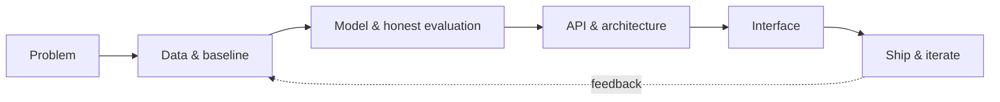

---

## 👋 About me

I'm an **AI engineer and full-stack developer** from Algeria. I like the full path from data to product: modelling a problem, evaluating it honestly, then building the API and interface people actually use.

- 🎓 **Master's Final Studies Project (PFE):** a brain-computer interface that detects motor intent from 30-channel EEG, using Riemannian/CSP features and EEGNet, with drift-null and confound controls and a real-time LSL replay. → [`eeg-motor-intent-decoder`](https://github.com/ORD1STAR/eeg-motor-intent-decoder)
- 🎓 **Licence Final Studies Project (PFE):** a role-based university portal with timetables, grades, exams, files and real-time chat, built with a teammate. → [`usthb-student-portal`](https://github.com/ORD1STAR/usthb-student-portal)
- 🧪 I report results honestly, including baselines, leakage risks and limitations, because a number without context isn't worth much.
- 🛠️ I build tools for real users: inventory and invoicing for small businesses, multilingual storefronts with RTL support, community bots and competition platforms.

## 🧰 Tech stack

**AI / Data**

**Full-stack**

**Data stores & tooling**

Also used across projects: **MNE-Python, LightGBM, XGBoost, CatBoost, Socket.IO, Three.js, Framer Motion, next-intl, discord.py, Nx**.

## 🚀 Featured projects

### 🤖 AI & machine learning

| Project | What it is | Stack |
|---|---|---|
| [**eeg-motor-intent-decoder**](https://github.com/ORD1STAR/eeg-motor-intent-decoder)   `Master's PFE` | Brain-switch BCI from 30-channel EEG with honest controls (drift nulls, eye confounds) and a real-time replay | MNE · pyRiemann · PyTorch · LSL |
| [**xau-price-predictor**](https://github.com/ORD1STAR/xau-price-predictor) | Gold direction forecasting with a stacking ensemble and purged walk-forward CV, evaluated against an always-up baseline | LightGBM · XGBoost · CatBoost · PyTorch |
| [**neural-arena**](https://github.com/ORD1STAR/neural-arena) | Self-hosted ML competition platform with team auth, CSV scoring and a live leaderboard | Flask · SQLite · scikit-learn |
| [**multi-agent-chat-arena**](https://github.com/ORD1STAR/multi-agent-chat-arena) | Autonomous Claude agents that chat, debate and hold mock trials | Node.js · SSE |
| [**string-matching-and-aco-algorithms**](https://github.com/ORD1STAR/string-matching-and-aco-algorithms) | Aho-Corasick, Boyer-Moore, Rabin-Karp and ant colony optimization from scratch, with benchmarks | Python |
| [**genetic-plate-packing-optimizer**](https://github.com/ORD1STAR/genetic-plate-packing-optimizer) | Genetic algorithm for 2D cutting-stock packing | Python · NumPy |

### 🌐 Full-stack & products

| Project | What it is | Stack |
|---|---|---|
| [**stockily**](https://github.com/ORD1STAR/stockily) | Multi-tenant stock, quality and invoicing platform with a hexagonal architecture | Nx · NestJS · React · Prisma · PostgreSQL |
| [**elevate-digital**](https://github.com/ORD1STAR/elevate-digital) | Trilingual (AR/FR/EN, RTL) storefront with three themes including glassmorphism | Next.js 16 · Express · MongoDB |
| [**usthb-student-portal**](https://github.com/ORD1STAR/usthb-student-portal)   `Licence PFE` | University portal with timetables, grades, exams, files and chat | Node · Express · Socket.IO · MySQL |
| [**voxel-sandbox**](https://github.com/ORD1STAR/voxel-sandbox) | Browser voxel game with procedural terrain, crafting and mobs | TypeScript · Three.js |
| [**couzinet-kitchens**](https://github.com/ORD1STAR/couzinet-kitchens) | Animated showcase site for a kitchen workshop | React · TypeScript · Framer Motion |
| [**web-design-showcase**](https://github.com/ORD1STAR/web-design-showcase) | Six responsive landing pages and a data-driven form | HTML · Tailwind |

### 🤝 Bots & tools

[**exam-auto-grader**](https://github.com/ORD1STAR/exam-auto-grader) · [**hr-assistant-bot**](https://github.com/ORD1STAR/hr-assistant-bot) · [**debibot-discord-community-bot**](https://github.com/ORD1STAR/debibot-discord-community-bot)

## 🧭 How I work

- **Evaluate before you celebrate:** baselines, leakage checks and recording-wise splits come first.
- **Architecture that stays readable:** domain logic kept separate from frameworks, typed end to end.
- **Details users notice:** localisation, RTL, accessibility and sensible empty states.

## 📫 Let's talk

I'm looking for **AI engineering and full-stack roles**. If you'd like to collaborate or talk about a project, reach me on [LinkedIn](https://www.linkedin.com/in/hannoun-amine/) or at **hannoun.amine25@gmail.com**.

